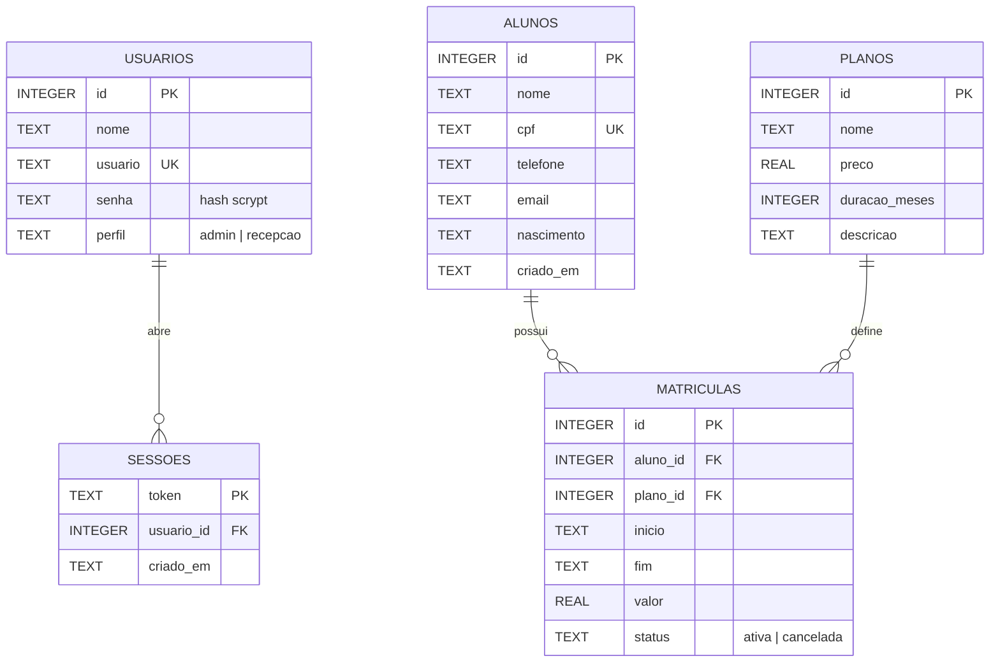

# 3. Estrutura do banco de dados

SGBD: **SQLite**, acessado pelo módulo nativo `node:sqlite` do Node.js 22. O arquivo fica em `backend/data/academia.db` e é criado automaticamente na primeira execução, com dados de demonstração. Chaves estrangeiras ativadas (`PRAGMA foreign_keys = ON`).

## Diagrama entidade-relacionamento

## Tabelas

### `usuarios` — equipe com acesso ao sistema
| Coluna | Tipo | Restrição | Descrição |
|---|---|---|---|
| id | INTEGER | PK, autoincremento | Identificador |
| nome | TEXT | NOT NULL | Nome exibido |
| usuario | TEXT | NOT NULL, UNIQUE | Login |
| senha | TEXT | NOT NULL | Hash `scrypt` com salt (nunca a senha pura) |
| perfil | TEXT | NOT NULL, padrão `admin` | `admin` ou `recepcao` |

### `sessoes` — sessões de login ativas
| Coluna | Tipo | Restrição | Descrição |
|---|---|---|---|
| token | TEXT | PK | Token aleatório enviado em cookie `HttpOnly` |
| usuario_id | INTEGER | FK → usuarios(id), ON DELETE CASCADE | Dono da sessão |
| criado_em | TEXT | padrão `datetime('now')` | Data/hora do login |

### `alunos`
| Coluna | Tipo | Restrição | Descrição |
|---|---|---|---|
| id | INTEGER | PK | Identificador |
| nome | TEXT | NOT NULL | Nome completo |
| cpf | TEXT | NOT NULL, UNIQUE | CPF (formato 000.000.000-00) |
| telefone | TEXT | padrão `''` | Telefone |
| email | TEXT | padrão `''` | E-mail |
| nascimento | TEXT | padrão `''` | Data de nascimento (AAAA-MM-DD) |
| criado_em | TEXT | padrão `date('now')` | Data de cadastro |

### `planos`
| Coluna | Tipo | Restrição | Descrição |
|---|---|---|---|
| id | INTEGER | PK | Identificador |
| nome | TEXT | NOT NULL | Ex.: Mensal, Trimestral, Anual, Premium |
| preco | REAL | NOT NULL, `CHECK (preco >= 0)` | Valor mensal |
| duracao_meses | INTEGER | NOT NULL, `CHECK (duracao_meses > 0)` | Duração do plano |
| descricao | TEXT | padrão `''` | O que o plano inclui |

### `matriculas`
| Coluna | Tipo | Restrição | Descrição |
|---|---|---|---|
| id | INTEGER | PK | Identificador |
| aluno_id | INTEGER | FK → alunos(id), ON DELETE CASCADE | Aluno |
| plano_id | INTEGER | FK → planos(id) | Plano contratado |
| inicio | TEXT | NOT NULL | Data de início |
| fim | TEXT | NOT NULL | Vencimento = início + duração do plano |
| valor | REAL | NOT NULL | Preço do plano no momento da matrícula |
| status | TEXT | `CHECK (status IN ('ativa','cancelada'))` | "Vencida" é calculada: ativa com `fim` < hoje |

## Dados iniciais (seed)
- Usuários: `admin` / `academia123` (Administrador) e `recepcao` / `recepcao123` (Recepção).
- Planos: Mensal (R$ 99,90 · 1 mês), Trimestral (R$ 89,90 · 3), Anual (R$ 69,90 · 12), Premium (R$ 149,90 · 1).
- 12 alunos e 11 matrículas distribuídas nos últimos 6 meses, para os gráficos do painel.
